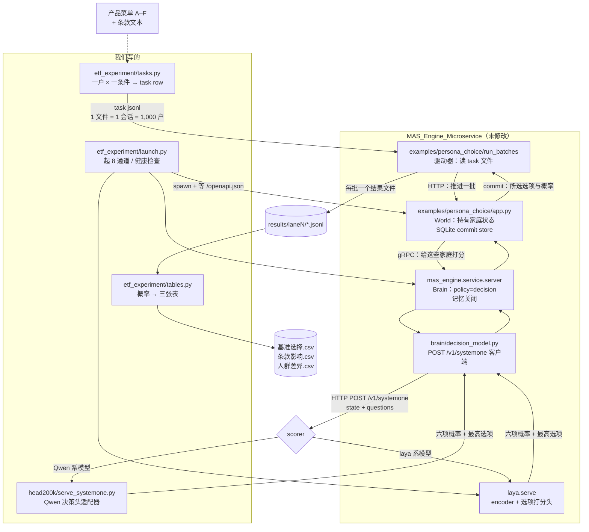
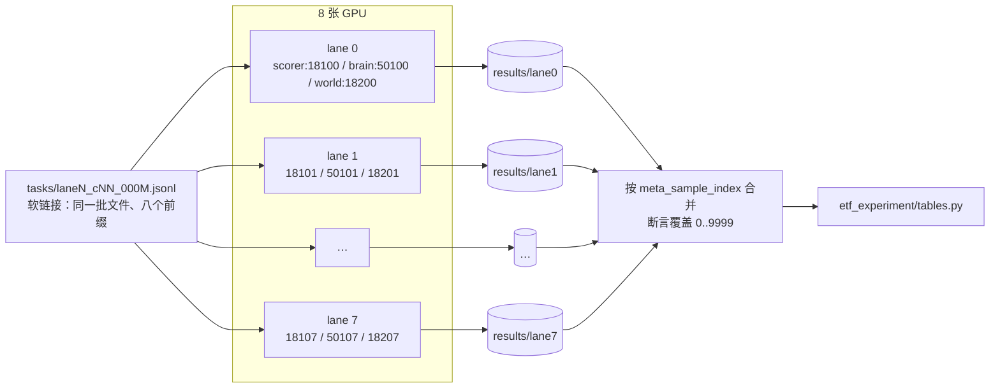
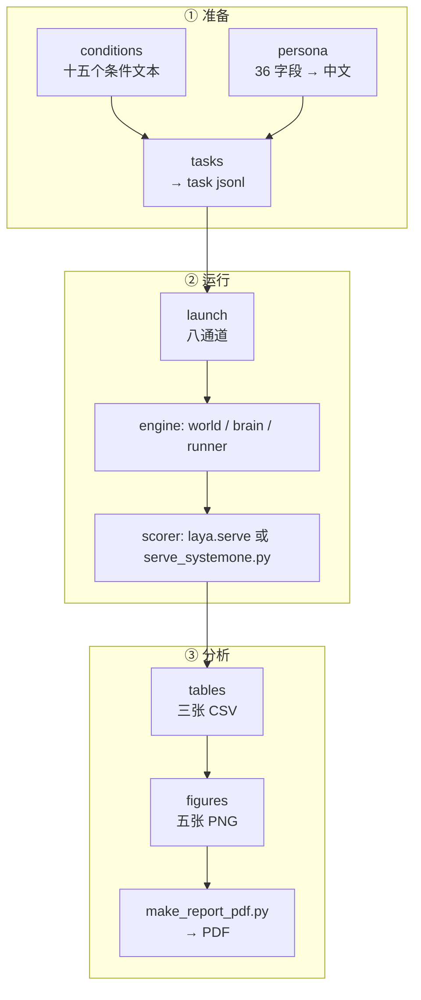

# 实验如何调用 MAS 引擎

两张图：一张是**一次决策**，一张是**八通道批量运行**。两张图都在回答同一个问题：
**哪些部分是引擎，哪些部分是我们自己写的。**

---

## 1. 一次决策

### 边界在哪

橙色框是引擎原样。我们只向它提供三样东西，只从它取一样东西：

| 接口 | 方向 | 契约 |
|---|---|---|
| `MAS_PERSONA_TASKS_DIR` | 入 | 我们的 task jsonl，用引擎的 `agent_id / task / meta` schema |
| `POST /v1/systemone` | 入 | 我们的 scorer 必须返回六个选项的概率与最高选项 |
| `DECISION_MODEL_*` 环境变量 | 入 | 模型名、端口、超时、语言、max_len |
| `results/laneN/*.jsonl` | 出 | 每户每条件一行：六项概率、`option_id`、`status` |

**没有别的东西跨越这条线。** 引擎看不到我们的 CSV 表，也看不到条件定义；
它只看到渲染好的 `state` 和 `questions`。这一层隔离是关键：改条件文本不会
影响引擎，改引擎不会影响我们的统计口径。

### 我们自己的模块

| 模块 | 职责 | 为什么必须是我们的 |
|---|---|---|
| `conditions.py` | 十五个条件的题面文本 | 条款措辞本身就是处理变量，必须逐字冻结 |
| `persona.py` | 36 字段 → 中文画像段落 | 同一户在十五个条件下必须渲染出同一段文本 |
| `tasks.py` | 拼装 task row、算 `input_sha256` | 决定模型看到什么，也决定可复现性 |
| `launch.py` | 起 8 通道、等健康、发运行 | 引擎只管单通道，多卡编排在这里 |
| `serve_systemone.py` | Qwen 决策头实现 `/v1/systemone` | 引擎只认得 laya 系，Qwen 系要自己接 |
| `stats.py` / `tables.py` / `figures.py` | 估计、三张表、五张图 | 引擎不产出论文口径的结果 |

---

## 2. 八通道批量运行

**为什么用软链接。** `run_batches --batches laneN_` 按文件名前缀挑选一个会话的输入。
把八个前缀都指向同一批条件文件，就能让每个条件在八条通道上并行各打一遍，
而不必把 380 MB 复制七次。

**为什么按 index 合并。** 八条通道完成顺序不同，直接拼接文件会让住户错位。
`tables.py` 断言合并结果恰好覆盖 `0..9999`，否则报错而不是静默出错表。

**端口规则。** 三个区间必须互不相交：scorer 在 181xx、brain 在 501xx、world 在 182xx，
每条通道 +1。这些数字与磁盘上已有的日志目录一致，所以新旧运行的日志能对上。

---

## 3. 引擎具体为我们做了什么

| 引擎能力 | 实验为什么需要 |
|---|---|
| World 持有家庭状态，每次决策后 commit | 两拍实验要把上一轮成交结果写回 `当前事件` 再问一次 |
| `MAS_BRAIN_MEMORY_ENABLED=0` | 每个条件必须独立，不能带上一题的记忆 |
| Brain 的 `policy=decision` | 把"给所有选项打分"转成一次互斥选择，输出六项概率 |
| `run_batches` 的重试与按批落盘 | 15 万次决策的运行可以断点续跑，不必重做已完成的批 |
| 每通道独立进程组 | 8 张卡各自加载模型，互不争用 |

**一处必须绕开的引擎行为。** 引擎的 batch server 会用一个窗口内**第一条请求**的选项顺序
给整批打分，而每户的展示顺序都不同，于是概率被静默乱序。`rescore.py` 只为改正这一点而存在，
不在主路径上；现在的 launcher 已经避开了会触发它的批量模式。

---

## 4. 各脚本的位置

三段之间只通过文件交接，所以任一段都可以单独重跑：

- 只改了条款文本 → 重跑 ① 和 ②；
- 只想换统计口径 → 用已归档的逐户结果重跑 ③，不需要 GPU；
- 只想换图 → 用三张 CSV 重跑 `figures`。
