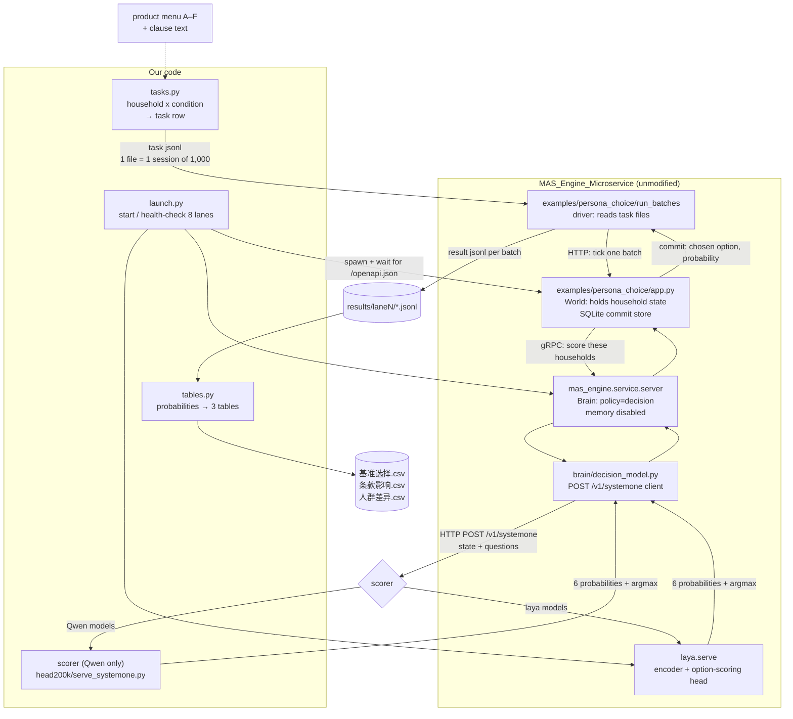
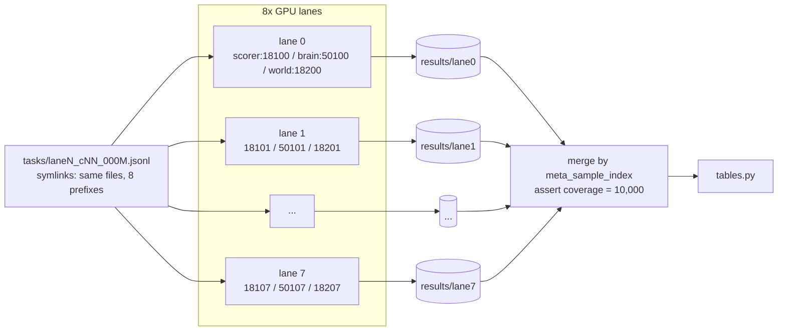
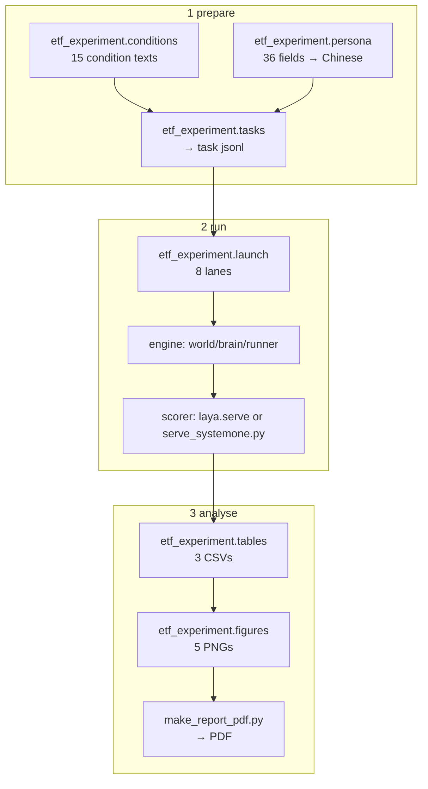

# How the experiment calls the MAS engine

Two diagrams: one for a single decision, one for the eight-lane batch run. The
question both answer is **which parts are the engine and which parts are ours**.

## 1. One decision

**Reading the boundary.** The orange engine box is the engine as shipped. We
supply three things it asks for and consume one thing it produces:

| Interface | Direction | Contract |
|---|---|---|
| `MAS_PERSONA_TASKS_DIR` | in | our task jsonl, engine's `agent_id/task/meta` schema |
| `POST /v1/systemone` | in | our scorer must answer with six option probabilities |
| `DECISION_MODEL_*` env | in | our model name, base URL, timeouts, language |
| `results/laneN/*.jsonl` | out | probability per option, `option_id`, `status` |

Nothing else crosses the line. In particular the engine never sees our CSV
tables or our condition definitions; it only sees rendered `state` and
`questions`.

## 2. The eight-lane batch run

Why symlinks: `run_batches --batches laneN_` selects a session's inputs by
filename prefix. Pointing all eight prefixes at the same condition files means
each condition is scored once per lane in parallel without copying 380 MB seven
times.

Why merge by index: the eight lanes finish out of order, so concatenating files
would misalign households. `tables.py` asserts that the merge covers exactly
`0..9999` and raises otherwise.

## 3. What the engine is actually doing for us

| Engine feature | Why the experiment needs it |
|---|---|
| World holds household state and commits after each decision | the two-tick round writes the realised outcome back into `当前事件` and asks again |
| `MAS_BRAIN_MEMORY_ENABLED=0` | each condition must be independent; no memory means no carry-over from the previous question |
| Brain's `policy=decision` | converts "score all options" into one exclusive choice with six probabilities |
| `run_batches` retries and per-batch output | a 150,000-decision run can resume without redoing finished batches |
| One process group per lane | 8 GPUs, each with its own model copy, no cross-lane contention |

The one engine behaviour we had to work around: its batch server scored a whole
window using the *first* request's option order. Because every household has its
own display order, that silently permuted the probabilities. `rescore.py` exists
only to re-score those windows with per-household order and is not part of the
main path; the launchers now avoid the batching mode that triggers it.

## 4. Where each script sits

