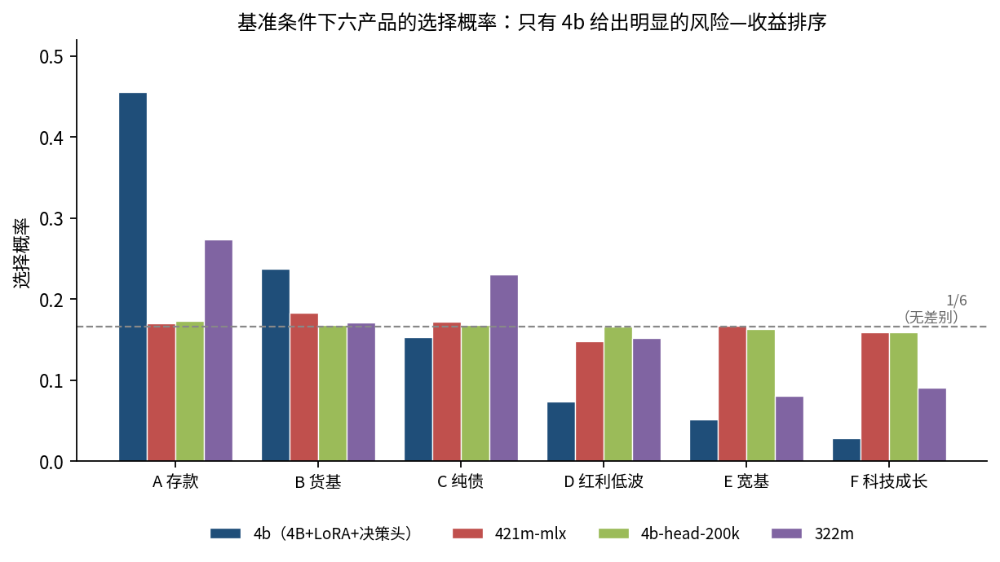
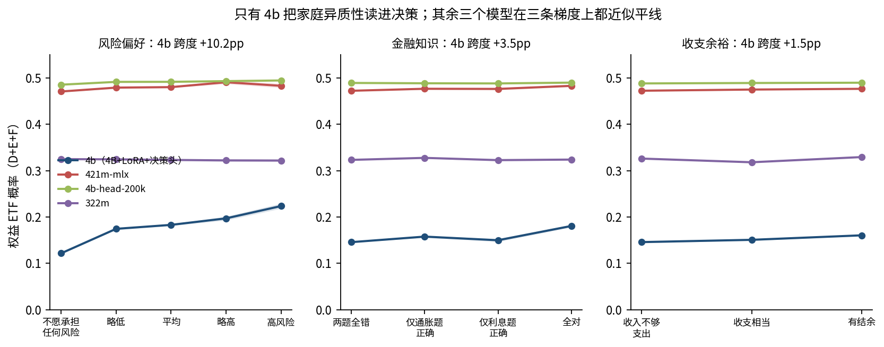
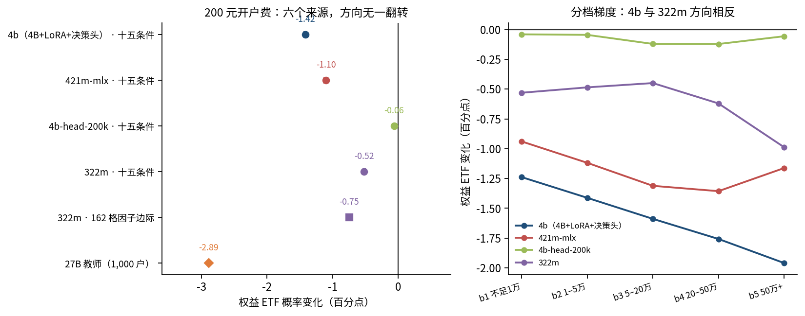
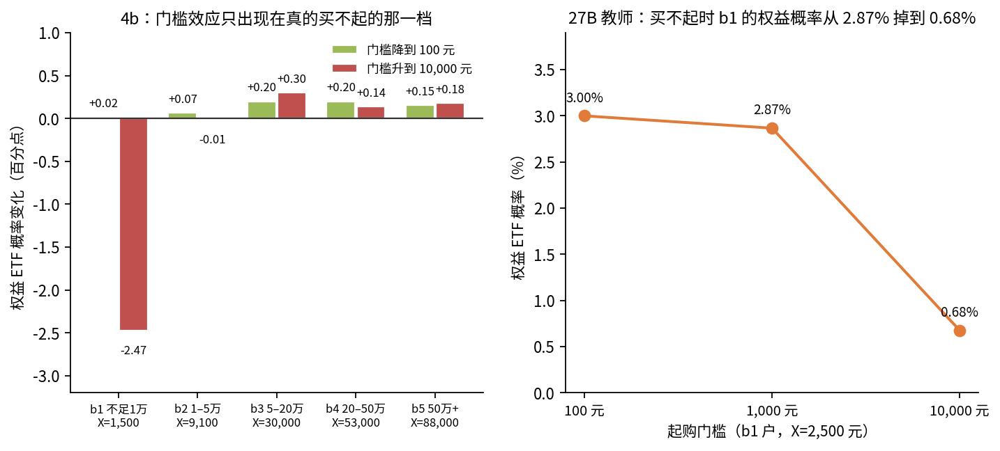
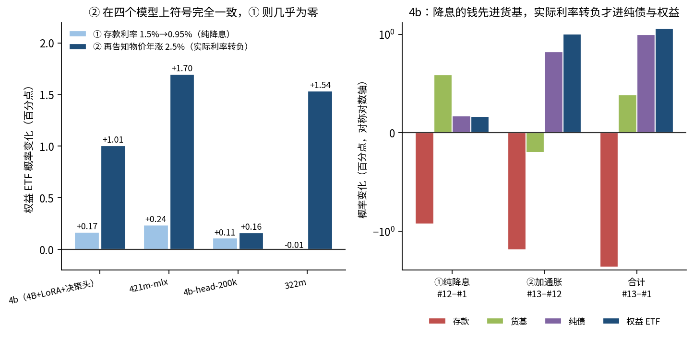

# 存款为什么不进 ETF：家庭产品条件对照实验

**面向基金公司、券商与银行财富管理团队** ｜ 版本 2026-11-02 ｜ 数据、口径与全部数字都取自本目录已有产物，未重跑任何打分

---

## 引言

ETF 实验面向基金公司、券商及银行财富管理团队，研究不同家庭在什么条件下愿意配置 ETF，以及愿意投入多少资金。我们以真实家庭调查为基础，构建涵盖收入、支出、资产、负债和风险偏好等 36 项信息的家庭画像，按资产与风险特征分层选取一万户当前未参与投资的画像，开展产品条件对照实验。目前，sharp-322m、sharp-421m（YN-mini）、sharp-4b-head-200k、sharp-4b 四种专用决策模型正各开展一万户实验，系统比较费用、产品说明、投资门槛与配置方式对选择的影响。模型直接对备选方案评分，支持批量、可重复的实验和跨模型比较。项目同时关注参与人数与资金配置，帮助机构识别不同客群的响应、筛选产品方案，并确定真实客户测试的优先级，将家庭数据与金融决策模型转化为产品设计和客户经营的研究能力。

> **当前进度（截至 2026-11-02）。** 十五条件、因子设计、两拍闭环、句子安慰剂、文本探针五轮已全部完成，四个模型各 150,000 条以上逐户结果可用，本文的所有数字来自这批已完成结果。第六轮（34 个实验包，每模型 162 万行）仍在进行：`sharp-322m`、`sharp-421m` 已出齐；`sharp-4b-head-200k` 已完成 738,960 行，占 45.6%；`sharp-4b` 排队中。该轮结果尚未进入本文结论。

这份文档是上述实验到目前为止的**结果汇总与解读**。它回答三件事：一，六轮实验各自怎么设计、识别的是什么；二，哪些结果经得起跨模型复核、哪些只在单一模型上成立；三，把这些结果对应到经济学机制上，并说明在产品与客户经营上可以怎么用。

---

## 摘要：给机构读者的三页

### 一句话

**在这批模型行为里，"价格"（费用、利率）和"门槛"确实以经济学预测的方向起作用，而且换到更大的 27B 模型上方向被独立复现；但呈现方式（字数、措辞、标签、选项顺序）的弹性与它们同量级甚至更大；而"流动性限制"和"买不到"这两类约束，在本批模型里都没有表现出理论预期的抑制效应。**

### 已经可以用来筛方案的（稳健）

| 结论 | 关键数字 | 证据 |
|---|---|---|
| **一次性开户费压权益参与，且把客户推给"免开户"的替代品** | 200 元 → 权益 −1.42pp（4b）；权益流出 1.42pp 中货基 +0.62、纯债 +1.15、**存款还净流出 0.36** | 6 个来源同向（4 个模型 + 因子设计 + 27B） |
| **起购门槛只约束"真的买不起"的那一档，且挡人强、放宽弱** | 抬到 1 万元：b1 权益 −2.47pp，b2（只差 900 元）−0.01pp；降到 100 元只回收 +0.08pp | 4b 剂量反应 + 27B 复现（2.87%→0.68%） |
| **存款实际利率转负才改变资产类别，名义降息只做同类替代** | 降息 55bp：货基 +0.59pp、权益 +0.17pp；再加 2.5% 通胀：权益再 +1.01pp、货基反而 −0.20pp | 4 个模型符号全一致（+0.16 到 +1.70pp） |

### 需要先做客户测试、不能直接用的（不稳）

| 结论 | 为什么不稳 |
|---|---|
| **申购费（比例费用）对权益的净方向** | 同一个 `sharp-322m`：单条款条件 **+0.39pp**，162 格因子设计 **−1.23pp**，符号相反 |
| **回撤信息的效应** | 四个模型四种符号：4b −1.12、322m −4.31、421m +1.16、27B +1.19pp |
| **"存款打底 + 小比例 ETF"的参与率提升** | 322m +11.18、4b +10.00、421m **−11.73pp**；但四模型权益金额**全部为负**（−2,520 到 −7,440 元/户） |
| **200 元开户费对哪一档更狠** | 4b/421m 是大账户降更多，322m 因子是小账户降更多；方向相反 |

### 目前不能回答的

- **不是真人。** 全部数字是"决策模型在合成画像上给出的选择分布"，可以说明条款如何改变决策面，不能直接换算成真实客户的转移比例。
- **流动性条款**（30 日锁定 / 赎回费）在五个模型上都没有稳定压低权益（−0.33 到 +1.83pp，符号不一致），与理论预期相反。
- **"买不到"没有被内化成约束**：写明"上一轮未成交"让概率**上升** 1.59–2.35pp，不是下降。
- **两拍闭环（把成交结果写回状态再问一次）当前设计失效**：`sharp-4b` 有 97% 第一拍选存款，导致"买不到"这一臂实际 0 户；两拍变化约 +14pp 主要来自"确认你的选择"，与条款无关。详见第四节 4.7。

### 规模与可重复性

| 轮次 | 设计 | 规模 |
|---|---|---|
| ① 十五条件（无记忆） | 1 基准 + 14 个单条款偏离，逐户配对 | 10,000 × 15 × 4 模型 = **600,000** 次选择 |
| ② 因子设计 | 费用 3 × 门槛 3 × 流动性 3 × 信息 3 × 利率 2 = 162 格全交叉 | 10,000 × 162 ≈ **162 万** 次 |
| ③ 两拍闭环 | 成交结果写回状态再选一次 | 10,000 × 3 题 × 4 模型 = **120,000** 次 |
| ④ 句子安慰剂 | "未成交"真句 vs 等长中性句 | 5,600 户 × 2 臂 × 2 模型 = **22,400** 次 |
| ⑤ 文本探针 + 27B 教师 | 词汇替换、同义改写、位置随机化（15 条按户随机顺序 × 1 万户）；27B 教师复核 10 个条件 × 1,000 户 | 探针 4 + 位置 15，各 10,000 次；教师 1,000 户 × 10 条件 |
| ⑥ 34 实验包（进行中） | 统一到同一批户、同一套补全 | 每模型 **1,620,000** 行；322m/421m 已出齐，head-200k 与 4b 仍在跑 |

调用一律走 MAS 引擎同步接口，一户一次请求，不截断、不开跨题记忆；概率是 softmax 之后的输出。抽样种子、选项顺序、bootstrap 种子（B=1,000）全部固定，可逐户复现。

### 模型命名对照

| 文档中 | 论文/卡片中的模型 | 结构 |
|---|---|---|
| `sharp-322m` | FinL-bilingual（原生 PyTorch） | ~322M 双语 encoder + 选项打分头 |
| `sharp-421m-mlx`（YN-mini） | FinL-mlx（MLX FP16，完整六轮） | 421M 级，`convaiinnovations/laya` 基座微调 |
| `sharp-4b-head-200k` | FinQ head-only · 200k QA | Qwen3.5-4B-Base + 决策头（不带 LoRA） |
| `sharp-4b` | FinQ · 200k QA | Qwen3.5-4B-Base + LoRA + 决策头 |

四个模型共用同一套"打分全部备选方案 → 转成选择概率"的接口，因此同一户、同一题在四个模型上可以直接配对比较。**它们的基准分布差异很大（权益概率从 0.153 到 0.489），所以任何效应表都必须标模型，不能合并。** 第四节 4.2 给出选择哪个模型来做主结果的理由。

---

## 怎么读这份文档

全文的"稳"是一个可核查的标准，不是修辞：

1. **方向**与预先写定的经济学预测一致（成本上升抑制需求、约束收紧降低参与、风险信息改变组合构成等）；
2. **95% 家庭聚类区间**不跨 0；
3. **至少两个独立来源同向**：不同模型、不同金额版本（老 X / 新 X）、不同设计（单条款 / 162 格交叉 / 两拍 / 27B 教师），或经得起操纵检验（长度安慰剂、标签对照、位置随机化、同义改写）。

第 3 条是本文与原始实验方案的差别所在。核对逐户文件时发现，若干在单模型上看起来很强的效应（尤其是两拍闭环）在其他模型上符号相反、甚至机械失效；这些条目已逐条降级，写清原因，并集中列在第六节。

**措辞约定。** 模型给出的概率是"倾向"，不是真实成交。文中一律写"模型把多少概率放在某产品上"，不写"家庭买了多少"。"pp"指百分点（两个概率之差），不是相对百分比。

---

## 一 要回答的问题

> 对当前没有任何基金或股票持仓的家庭，**费用、资金门槛、流动性限制、产品信息与呈现方式**，各让多少概率从存款挪到货币基金、纯债基金和权益 ETF？哪一类家庭挪得最多？

这个问题在机构层面有两个具体用途：**筛产品方案**（哪些条款值得改、改了能挪多少）和**定客户优先级**（哪一类客群对哪一类条款最敏感，值得先做真人测试）。它对应的现实问题不是收益差不明显（存款 1.5% 对宽基 8%），而是摩擦、门槛、流动性顾虑和信息理解——实验的设计目标就是把这些摩擦拆成可单独识别的几项。

---

## 二 设计

### 2.1 样本：固定一万户，做面板而不是横截面

从本地 1,000 万条合成家庭画像（按 CFPS、CHFS、CGSS、CLDS 构造，36 字段）筛出 `investment_activity == none` 的 **9,130,025 户**，按**资产五档 × 风险偏好六类 = 30 层**分层，最大余数法分配后等概率无放回整行抽取 **10,000 户**。种子 `20261021`（PCG64）。

- 资产档配额 3,000 / 2,600 / 2,400 / 1,200 / 800，刻意抬高 b4、b5 的抽样比，便于比较中高资产家庭；汇总时用 `(N_h/N)/(n_h/10000)` 还原到总体。
- **同一户走完全部条件**，每个条件独立作答，前一次选择不带进下一次。这是本设计最关键的一点：所有比较都是**户内配对**，家庭画像、收支、闲置金额、选项顺序全部固定，剩下的差别只来自被改动的那一句条款。
- 闲置资金 X 用 CFPS 2018 外部校准值：**1,500 / 9,100 / 30,000 / 53,000 / 88,000 元**（旧版为 2,500 / 15,000 / 62,500 / 175,000 / 312,500）。新 X 的意义是让"起购 1 万元"这道门槛真的把 b1、b2 挡在外面（5,600 户），从而把"参与边际"和"强度边际"分开。

### 2.2 菜单

| 产品 | 一年参考总回报 | 压力情景总回报 | 关键条款 |
|---|---|---|---|
| A 一年期存款 | 1.5% | 到期保本保息 | — |
| B 货币基金 | 2.0% | 低风险不保本 | 1 元起购，随取随用 |
| C 纯债基金 | 3.5% | −1.5% | 基准 1,000 元起购 |
| D 红利低波 ETF | 6.0% | −12% | 同上 |
| E 宽基指数 ETF | 8.0% | −25% | 同上 |
| F 科技成长 ETF | 12.0% | −40% | 同上 |

A–F 对应关系全程固定；每户的**展示顺序随机一次并固定**，结果映射回固定编号。模型输出六项概率与最高选项，主指标是 `1−p_A`（离开存款）、`p_C+p_D+p_E+p_F`、`p_D+p_E+p_F`、以及按概率折算的 ETF 金额。

### 2.3 六轮实验

| 轮次 | 设计 | 规模 | 回答什么 | 产物 |
|---|---|---|---|---|
| ① 十五条件（无记忆） | 1 基准 + 14 个单条款偏离，逐户配对 | 10,000 × 15 = 150,000/模型 | 单条款的边际效应与人群差异 | `etf_output_results/new/<模型>/表/` |
| ② 因子设计 | 费用 3 × 门槛 3 × 流动性 3 × 信息 3 × 利率 2 = **162 格**，户内全交叉 | 10,000 × 162 + 安慰剂 ≈ 1,640,000 | 交互项、以及"单条款相加是否等于联合效应" | `factorial/outputs/` |
| ③ 两拍闭环 | 把上一拍成交结果写回 state 再选一次（#4 费、#6 门槛、#8 锁定） | 10,000 × 3 × 4 模型 = 120,000 | 描述性条款与"已实现状态"差多少 | `results/tick2_main/` |
| ④ 句子安慰剂 | #6 买不到的 5,600 户随机对半：真句 vs 等长中性句 | 5,600 × 2 模型 | 效应来自内容还是长度/复述 | `results/placebo_c06/` |
| ⑤ 文本探针与教师对照 | 词汇替换、ETF 前置、同义改写、位置随机化；27B 教师 1,000 户 | 10,000 × 若干 + 1,000 × 10 | 呈现效应有多大、换更强的模型方向是否成立 | `probes/` |

模型为四个本地决策模型：`sharp-322m`（322M 双语 encoder + 选项打分头）、`sharp-4b`（Qwen3.5-4B-Base + LoRA + 决策头）、`sharp-4b-head-200k`、`sharp-421m-mlx`。调用一律走 MAS 引擎同步 `/v1/systemone`，一户一次请求，不截断、不开跨题记忆；概率是 softmax 之后的输出，四条通道并行打分每轮约 40–66 分钟。

第 ⑥ 轮（`run3_20261030`）把报告里出现的 34 个实验统一到同一批 10,000 户、同一套五维补全，每模型 1,620,000 行，四模型 × 8 通道并行。**截至本文写作时的状态：`sharp-322m`、`sharp-421m` 已出齐 1,628 个结果文件（含每通道 manifest），`sharp-4b-head-200k` 进行到 739/1,620，`sharp-4b` 排队中。**因此本轮结果尚未进入本文的正向结论，只在第六节登记状态。

### 2.4 估计

每题先算**同一户的差**，再按抽样权重重平均；区间用**家庭聚类 bootstrap**（B=1,000，种子 `20261021`，同一户的各条件、两拍绑在一起抽）。因子设计的边际效应是"把该因子固定在一档，对其余因子全部组合取平均，再减基准档"，另配条件 logit 把六项概率当选择分布、允许系数与低资产/有负债/风险偏好相乘。

---

## 三 为什么这些数字可以当因果读

三条操纵检验，作用相当于实验经济学的 manipulation check：

**（1）长度安慰剂。** 只把"红利低波"的选项文本拉长到和"按季分红"一句等长，不增加任何事实：该选项 −0.63pp，三只权益合计 **+0.54pp**。而同义改写（意思不变、字数增加）把纯债推高 **+4.67pp**。结论：文本变长本身会挪 0.5 个百分点量级，**凡是小于 0.5pp 的"效应"都不该单独下结论**；反过来，1pp 以上的条款效应不是字数造成的。

**（2）句子安慰剂（#6，b1+b2 的 5,600 户随机对半，字符数完全相同）。**

| 组 | 模型 | C–F 概率变化 | 存款变化 |
|---|---|---:|---:|
| 真句"上一轮选择未成交…" | sharp-4b | **+0.85pp** | −1.43pp |
| 等长中性句"上一轮选择已保存…" | sharp-4b | −0.74pp | +0.56pp |
| 两者之差 | sharp-4b | **+1.59pp** [1.54, 1.65] | — |
| 真句 | sharp-322m | +2.22pp | −0.82pp |
| 中性句 | sharp-322m | −0.13pp | +1.04pp |
| 两者之差 | sharp-322m | **+2.35pp** [2.25, 2.45] | — |

中性句是专门构造的：与真句**字符数完全相同**，且不含"未成交、门槛、10,000、不足、起购、资金、余额、持有、产品、元"任何一个词（`build_placebo_c06.py` 里有断言）。所以两臂唯一的差别就是**内容**。这个检验同时是一条负向结果：真句让 C–F **上升**，不是下降（见 4.12）。

**（3）基准校验：家庭画像是否进入决策。** `sharp-4b` 的权益概率从"不愿承担任何风险"0.122 到"高风险偏好"0.224（+10.2pp）；`sharp-421m-mlx` 是 0.471→0.483（+1.2pp）、`sharp-4b-head-200k` 0.485→0.495（+1.0pp）、`sharp-322m` 0.325→0.322（**−0.3pp**）。也就是说只有 `sharp-4b` 真正把风险偏好读进去了。这条校验决定了后面怎么读：**另外三个模型的条款效应接近 0，不能解释成"对条款不敏感"，而是它们先把家庭异质性抹平了。**

**（4）标签与位置对照。** 把 D–F 重写成"大部分存款 + 小部分 ETF"：组合一年收益约 1.6%，**低于货币基金的 2.0%**，存款部分还锁一年，理性上不该被选；结果三只组合的概率合计仍比基准高 **+7.47pp**，货币基金同时低 6.64pp。位置方面：把选项顺序随机化，**23.9% 的"户–条件"会改第一名**，纯债的位置效应 −1.94pp。

**但更重要的一句话是：这些检验只能定下界，不能保证结论有效。** 核对逐户文件时发现了两类更严重的问题，都发生在实验内部而非跨实验比较，必须单独列出（详见 4.7 与 4.12）：

- **配对失效**：两拍主实验里 `sharp-4b` 的第一拍有 97% 选存款，导致"买不到"这一臂实际为 0 户，主表报告的 −5.77pp 完全来自"确认存款"这句话；
- **确定性复读**：同一模型的第一拍最高选项在第二拍 100% 不变，两拍"变化"只是把概率集中到已选项（+14pp），不是重新决策。

也就是说，**安慰剂能证明"效应不是字数造成的"，但不能证明"效应是条款造成的"**——后者需要按实际收到的句子把样本拆开，这是本文对原始方案的主要修正。

意义很直接：**呈现效应的量级不小于多数条款效应**。因此本文所有条款结论都以"经得起这三条检验"为前提，并且把位置、标签、字数作为必须报告的对照项，而不是脚注。

---

## 四 结果

主结果按"稳不稳"分档，而不是按"哪一条最好看"排。`sharp-4b` 用得最多，因为它是唯一有完整金额列、且在单条款条件上不退化到单一选项的模型；凡引用因子设计（162 格）或两拍闭环的数字，都会单独标注模型。**符号在不同模型间不一致的条目一律标为"不稳"，不进入第七节结论。**

本节图 1–5 由 `make_summary_figs.py` 从已有表格直接绘制，不重跑打分；`figures/门槛分档_bootstrap.json` 是图 4 左panel 的中间结果（从逐户文件重算，B=1,000，种子 `20261021`）。

### 4.1 基准：六产品的分布本身就在给结论

`sharp-4b` 的基准分布是一条完整的向下阶梯：

| 产品 | 回报 | 压力情景 | 概率 | 相对上一档 |
|---|---:|---:|---:|---:|
| A 一年期存款 | 1.5% | 保本保息 | **0.456** | — |
| B 货币基金 | 2.0% | 低风险不保本 | 0.238 | −21.8pp |
| C 纯债基金 | 3.5% | −1.5% | 0.153 | −8.5pp |
| D 红利低波 ETF | 6.0% | −12% | 0.073 | −8.0pp |
| E 宽基指数 ETF | 8.0% | −25% | 0.052 | −2.1pp |
| F 科技成长 ETF | 12.0% | −40% | 0.028 | −2.4pp |

三个特征同时出现，构成后面所有条款分析的前提：

1. **回报从 1.5% 涨到 12%，概率从 0.456 单调降到 0.028。** 如果模型只看收益，F 应该最高；它最低，说明主导的是风险与保本属性。
2. **A→B 掉 21.8pp 是整条曲线上最大的一跳**，而 B 的回报（2.0%）只比 A 高 0.5pp、并且"低风险不保本"。这 21.8pp 就是**保本二字的定价**：在没有任何损失可能的前提下，家庭愿意放弃 0.5pp 收益；一旦要承担"不保本"，即使风险再低也要掉两成概率。
3. **D→E→F 的降幅在收窄**（−8.0、−2.1、−2.4pp），说明高风险段的边际排斥在减弱，符合风险厌恶系数递减（CRRA 下 u''(·) 的绝对幅度随财富下降）。

其余三个模型的分布几乎是平的，见下一节。

### 4.2 基准校验：只有 `sharp-4b` 把家庭画像读进决策

同一个基准菜单，按家庭画像切开后的权益 ETF 概率：

| 模型 | 风险偏好 不愿承担 → 高风险 | 金融知识 两题全错 → 全对 | 收支 无余裕 → 有结余 |
|---|---:|---:|---:|
| `sharp-4b` | 0.122 → 0.224（**+10.2pp**） | 0.146 → 0.181（**+3.5pp**） | 0.146 → 0.160（**+1.5pp**） |
| `sharp-421m-mlx` | 0.471 → 0.483（+1.2pp） | 0.472 → 0.483（+1.1pp） | 0.472 → 0.477（+0.4pp） |
| `sharp-4b-head-200k` | 0.485 → 0.495（+1.0pp） | 0.489 → 0.490（+0.1pp） | 0.488 → 0.490（+0.2pp） |
| `sharp-322m` | 0.325 → 0.322（**−0.3pp**） | 0.323 → 0.324（+0.1pp） | 0.326 → 0.329（+0.3pp） |

`sharp-4b` 的三条梯度**全部同向、全部显著**，而且量级与经济学直觉对得上：

- **风险偏好 +10.2pp。** 高风险组的权益概率是不愿承担风险组的 **1.84 倍**（0.224 / 0.122）。在均值–方差框架下，若两组的风险厌恶系数相差数倍，最优权益份额相差一倍以上是正常量级——10.2pp 的跨度与"风险厌恶系数异质"这一条一致，但本实验无法反推具体的系数值（菜单只有六个离散选项，无法识别无差异曲线的曲率）。
- **金融知识 +3.5pp。** 全对组 0.181，两题全错组 0.146，**相对高 24%**。这对应"参与成本随认知下降"（van Rooij et al. 2011 的金融素养—股市参与关系），且要注意：在这个实验里所有条款都已写明，金融知识的作用不是"看懂条款"，而是"愿意把条款换算成期望效用"。
- **收支余裕 +1.5pp。** 有结余 0.160、收入不够支出 0.146。幅度最小，但在预防性储蓄框架下方向正确：背景风险越高，风险资产的最优份额越低（Carroll 1997 的缓冲存量模型）。

更值得注意的是**金额侧的放大**：

| 分组 | 权益概率 | 折合 ETF 金额（元/户） | 该组加权平均 X（元） |
|---|---:|---:|---:|
| 不愿承担任何风险（4,500 户） | 0.122 | **1,808** | 13,997 |
| 高风险偏好（275 户） | 0.224 | **3,787** | 15,709 |
| 金融知识两题全错（5,999 户） | 0.146 | **2,351** | — |
| 金融知识全对（1,473 户） | 0.181 | **3,441** | — |
| 收入不够支出（2,227 户） | 0.146 | **2,181** | — |
| 收支有结余（3,706 户） | 0.160 | **2,997** | — |

高风险组相对不愿承担风险组，**概率高 1.84 倍、金额高 2.10 倍**，而两组的加权平均 X 只差 1.12 倍（15,709 / 13,997）。2.10 ≈ 1.84 × 1.12，说明**金额的额外放大全部来自资产规模**，概率本身的差异才是偏好差异。若按"每万元可投金额的权益暴露"算，两组分别是 2,411 元与 1,291 元，**高风险组高 87%**——比概率的 84% 还略高一点，因为高风险组的资产档分布略偏中高。"谁买"和"买多少"两个边际同时同向，这是异质性偏好在总体层面的完整投影。

（表中的 X 按 `meta_normalized_weight` 加权；各组 X 是情景设定值 1,500 / 9,100 / 30,000 / 53,000 / 88,000，不是每户真实余额。）

**这条校验为什么是解读一切的前提。** `sharp-421m-mlx`、`sharp-4b-head-200k`、`sharp-322m` 三个模型的基准几乎是"每条都 1/6"或"按回报排序但不看人"。它们的条款效应自然接近 0（`head-200k` 的 200 元开户费只有 −0.06pp）——那不是"对条款不敏感"，而是**先没有把家庭区分开，于是任何条款都没有可作用的边际**。所以在后文里，这三个模型只用于两件事：看方向是否被复现、看模型间是否有系统性矛盾；它们的量级一律不报。

### 4.3 固定费用：六个来源方向一致，无一翻转

200 元一次性开户费（只对纯债与三只 ETF 收取）：

| 来源 | 权益 ETF 变化 | 95% 区间 |
|---|---:|---|
| 27B 教师（1,000 户）· 权益 ETF | **−2.89pp** | — |
| `sharp-4b` · 十五条件 | **−1.42pp** | [−1.433, −1.398] |
| `sharp-421m-mlx` · 十五条件 | **−1.10pp** | [−1.136, −1.070] |
| `sharp-322m` · 162 格因子边际 | **−0.75pp** | [−0.760, −0.737] |
| `sharp-322m` · 十五条件 | **−0.52pp** | [−0.537, −0.502] |
| `sharp-4b-head-200k` · 十五条件 | **−0.06pp** | [−0.070, −0.059] |

**六个来源、四种模型、三种设计（单条款 / 162 格交叉 / 下一词概率），符号全部为负，没有一个翻转。** 这是本批实验里唯一一条跨模型完全一致的条款效应。

机制侧的证据更具体。`sharp-4b` 上这 200 元把钱推到哪里：

| 去向 | 变化 |
|---|---:|
| 存款 A | −0.36pp |
| 货基 B | **+0.62pp** |
| 纯债 C | **+1.15pp** |
| 红利低波 D | −0.67pp |
| 宽基 E | −0.45pp |
| 科技成长 F | −0.30pp |
| 合计 | 0.00 |

六个数字加起来正好为零，所以资金去向完全闭合：**权益 −1.42pp 中的 1.77pp 进了货基与纯债，而存款还净流出 0.36pp。**

值得注意的是：**200 元把权益推走 1.42pp，却没有一个铜板回到存款。** 如果只是风险态度变化，资金应当流向最安全的存款；实际是流向"无需新开基金账户、1 元起购"的货基（+0.62pp）和纯债（+1.15pp）——正好绕开这 200 元的开户门槛。**这证明起作用的是参与成本，不是风险偏好。**

金额侧：`#3−#1` 的 ETF 金额变化是 **−281 元/户**，在十五个条件里排第二（最大的是 #6 门槛 −471 元）。

### 4.4 固定费用的分档：方向一致，梯度有分歧

同一笔 200 元，在不同资产档上的抑制幅度：

| 组别 | 户数 | `sharp-4b` | `sharp-421m-mlx` | `sharp-322m` | 322m 因子 |
|---|---:|---:|---:|---:|---:|
| b1（X=1,500，200 元占 13.3%） | 3,000 | −1.24pp | −0.94pp | −0.53pp | **−0.94pp** |
| b2（X=9,100，2.20%） | 2,600 | −1.41pp | −1.12pp | −0.49pp | −0.63pp |
| b3（X=30,000，0.67%） | 2,400 | −1.59pp | −1.31pp | −0.45pp | −0.62pp |
| b4（X=53,000，0.38%） | 1,200 | −1.76pp | −1.36pp | −0.62pp | −0.59pp |
| b5（X=88,000，0.23%） | 800 | **−1.96pp** | −1.16pp | **−0.99pp** | −0.60pp |

两种梯度在数据里同时存在，必须分开说：

- **`sharp-322m` 的因子设计给出"小账户更受伤"**：b1 −0.94 到 b5 −0.60，单调递减。这与"固定参与成本 + 规模经济"（Vissing-Jørgensen 2002；Alan 2006）严格一致——200 元对 b1 等于 13.3% 的入场券，对 b5 只有 0.23%。
- **`sharp-4b` 与 `sharp-421m-mlx` 给出"大账户降得更多"**：4b 从 −1.24 升到 −1.96，421m 从 −0.94 升到 −1.36。

后者的读法是"绝对金额显著"：`sharp-4b` 把 200 元当成一笔**确定的现金支出**，扣在 88,000 元的组合上时，"少 200 元"这件事在它看来比"1,500 元少 200 元"更值得调整组合（因为大账户的调整空间更大、边际效用更平）。前者是"入场门票"读法。**哪个更接近真人，必须靠人类实验判定，本文不预设。**

能作为结论的只有方向那一条：**六个来源一致为负**。梯度方向不稳，所以第七节不据此给政策建议；唯一能说的是 b1 在两个读法下都是受抑制的档（−1.24 或 −0.94，都在 1pp 量级），而 b5 在两种读法下差三倍（−0.60 到 −1.96）。

金额侧有一个必须点明的机械关系：ETF 金额列的定义就是"该户可投入金额 × ETF 概率"，所以 `金额损失 ≈ Δ概率 × X`。b1 的 −44 元 = −1.24% × 1,500，b5 的 −1,757 元 = −2.0% × 88,000，**两边完全对得上**。因此金额随规模放大是定义使然，不能把金额列当作独立证据。

### 4.5 门槛：非凸预算集，只约束真的买不起的人

起购从 1,000 元抬到 10,000 元，`sharp-4b` 的分档反应呈**教科书式的断层**：

| 组别 | X | 与门槛的差 | 权益 ETF | 纯债或 ETF | 离开存款 |
|---|---:|---:|---:|---:|---:|
| b1 | 1,500 | **缺 8,500** | **−2.47pp** | **−5.29pp** | **−4.00pp** |
| b2 | 9,100 | **缺 900** | **−0.01pp** | −0.55pp | −0.72pp |
| b3 | 30,000 | 够 | +0.30pp | +0.11pp | −0.11pp |
| b4 | 53,000 | 够 | +0.14pp | −0.09pp | −0.32pp |
| b5 | 88,000 | 够 | +0.18pp | +0.02pp | −0.24pp |

三条读法：

1. **效应集中在预算集真的被切掉的那一档。** b1 缺 8,500 元，权益 −2.47pp、纯债或 ETF −5.29pp、离开存款 −4.00pp；b2 只缺 900 元，权益只有 −0.01pp（区间 [−0.021, −0.001] 虽然不跨 0，但幅度等于零）。**这不是"门槛越高越抑制"，而是"越买不起越抑制"**——一个纯粹的可行性约束，不是价格效应。
2. **对买得到的 4,400 户，抬高门槛甚至略微提高权益概率**（+0.14 到 +0.30pp）。这个反向效应量级小但一致，可以读成"高门槛显得更正规/更高端"的定位信号，也可以读成噪声（都在 0.3pp 内，接近长度安慰剂的 0.54pp 量级）。本文倾向前者但不作为结论。
3. **反向的不对称极大。** 把门槛从 1,000 元降到 100 元（`#5−#1`），b1 只回收 **+0.02pp**、b2 **+0.07pp**、b3 **+0.20pp**、b4 **+0.20pp**、b5 **+0.15pp**，全体 **+0.08pp**。也就是说：**把门槛挡住的损失（−2.47pp）是这个门槛放开后能回收的（+0.02pp）的一百倍以上。**

第 3 条是本批实验里最有政策含义的结果，原因很直接：1,000 元这道基准门槛对 b1 的 1,500 元、b2 的 9,100 元**本来就不构成约束**，所以把它降到 100 元什么也没解锁；而 10,000 元这道门槛对 b1 是硬约束，一加上就立刻切掉 2.47pp。**"挡人"和"放宽"作用在不同的人群上，因此效应量级不可比。** 任何"降低起购门槛能提升参与率"的推断，都必须先问当前门槛是否已经低于目标人群的可投金额。

27B 教师的独立复现给出同样的断层，而且幅度大一个量级：

| b1（X=2,500） | 权益 ETF 概率 |
|---|---:|
| 门槛 100 元 | 3.00% |
| 门槛 1,000 元 | 2.87% |
| 门槛 10,000 元 | **0.68%** |

从 2.87% 掉到 0.68%，相对降幅 76%；同时这 300 户的第一名落在 C–F 的户数从 **1.3% 降到 0**。也就是说，一个能力更强的模型在"买不起"这件事上不只是压低概率，而是**把不可行选项彻底排除出选择集**——这正是 `sharp-4b` 与 `sharp-322m` 都做不到的（见 4.13）。

### 4.6 比例费用：降幅不随账户规模变化，但方向不稳

`#4−#1`（申购费 0.5%，`sharp-4b`）：权益 ETF **−0.43pp**、ETF 金额 **−77 元/户**；纯债 −0.30pp；存款 +0.24pp。五个资产档的**权益概率降幅几乎一样**（b1 −0.45、b2 −0.41、b3 −0.44、b4 −0.41、b5 −0.39pp，最大最小差 0.06pp），这正是比例费用的特征：**相对价格对所有账户同比例上涨，参与边际上不区分大小账户。** 金额列的放大（−8 / −44 / −155 / −264 / −418）是 Δ概率 × X 的机械结果，不是额外信息。

这一点与 4.3–4.4 的固定费用形成有用的对照：**固定费用（200 元）在两个模型上的分档梯度都明显（虽然方向相反），比例费用（0.5%）在五个档上几乎是平的。** 这正是"固定成本 vs 比例成本"应当表现出的差别，而且在同一个模型内部对比，不受跨模型差异干扰。

但方向本身不稳。因子设计（`sharp-322m`）给出权益 −1.23pp、货基 −2.42pp、纯债 **+4.83pp**、存款 −1.18pp，看起来是"摩擦上升时资金先退到看起来免摩擦的纯债"。而**同一个 `sharp-322m` 在单条款条件 `#4−#1` 上给出权益 +0.39pp、存款 −2.85pp**——符号相反。所以 Tobin 税式的传导链在本批实验里没有稳定出现，只在 162 格交叉那一版出现一次。`sharp-4b` 的静态 `#4` 给出纯债 −0.30pp，也就是它没有把 0.5% 费用读成"纯债更划算"，只读成"所有非存款产品都贵了"。

**结论：申购费的"降幅不随规模变化"这一条在 4b 内部成立（0.06pp 的极差），可以作为比例成本的形态证据；但它对权益的净方向不稳，只能作为"参数扫描"保留，不能作为机制结论。** 与 4.3 的开户费形成鲜明对比——后者六个来源同向。

两拍 #4 的表观弹性（存款 +13.83pp、权益 −1.90pp、纯债或 ETF −5.70pp）**不能当作费用效应的放大**。原因见 4.7：在 `sharp-4b` 上，第一拍选 A 的 9,710 户在第二拍收到的句子是"30,000 元已存入一年期存款，持有至到期"——这句话在 #4、#6、#8 三题里**完全一样**，而三题给 A 组的效应分别是 +14.34pp、+16.55pp、+13.22pp。也就是说，两拍变化的绝大部分来自"确认上一轮选择"这件事本身，而不是费用、门槛或锁定。

### 4.7 两拍实验：状态回写被"确认偏误"主导，不能用来做条件放大

这一节是本文最重要的一处更正。原方案把两拍设计成"把上一拍的成交结果写回状态，看弹性是否放大"，主表也按题分组报告。核对逐户文件后发现三个问题，使 `sharp-4b` 的两拍数字不能按原意解读。

**问题一：`sharp-4b` 的第一拍有 97% 选存款，失败臂实际为空。**

| 模型 | b1+b2 户数 | 其中第一拍选 C–F、因而收到"未成交"句的户数 |
|---|---:|---:|
| `sharp-322m` | 5,600 | 574（10.2%） |
| `sharp-4b` | 5,600 | **0（0.0%）** |
| `sharp-4b-head-200k` | 5,600 | 932（16.6%） |
| `sharp-421m-mlx` | 5,600 | 2,368（42.3%） |

预注册的主结论是"#6 买不到的 5,600 户，纯债或 ETF 概率下降"。`sharp-4b` 这一格的 −5.77pp **完全不含任何"写明未成交"的户**——那 5,600 户里 5,448 户第一拍选了存款、152 户选了货基，无一户选 C–F。所以它测的不是门槛约束，而是"确认存款选择"。

**问题二：三题给存款组的是同一句话，效应也是同一个数。**

| 题 | 收到句（第一拍选 A 的户） | 户数 | Δ存款 | Δ纯债或 ETF |
|---|---|---:|---:|---:|
| #4 申购费 | "…已存入一年期存款，持有至到期。" | 9,710 | **+14.34pp** | −5.64pp |
| #6 起购 1 万 | 同一句 | 9,752 | **+16.55pp** | −6.54pp |
| #8 30 日锁定 | 同一句 | 9,682 | **+13.22pp** | −5.65pp |

三题的条款（0.5% 费用／1 万元门槛／30 日锁定）完全不同，给 A 组的句子却**逐字相同**，效应也都在 +13 到 +17pp 之间。这不是"条款被状态化后放大"，而是**"系统确认了你的选择"这一个动作本身把存款概率推高约 14pp**。

**问题三：第一拍最高选项在第二拍 100% 不变，且自选概率被机械抬高。**

| 模型 | 最高选项在第二拍不变的比例 | p(第一拍自选) 的变化 |
|---|---:|---:|
| `sharp-4b` | **100.0%**（三题都是） | +14.2 / +16.4 / +13.2pp |
| `sharp-322m` | 87.7% / 87.2% / 75.3% | −0.1 / +0.3 / −0.5pp |
| `sharp-4b-head-200k` | 91.5% / 91.7% / 93.2% | +0.3 / +0.4 / +0.3pp |
| `sharp-421m-mlx` | 69.0% / 71.5% / 71.2% | −0.1 / +0.1 / −0.1pp |

`sharp-4b` 是**确定性锁死**：第一拍选什么，第二拍就还选什么，一万户无一例外。它的两拍"变化"只表现为概率质量向已选项集中（+14pp），不是重新决策。其余三个模型的自选概率几乎不动（±0.5pp 以内），说明它们至少还在重新比较。

顺带一个反向的、可用的结果：安慰剂实验里，`sharp-322m` 的失败臂（真收到"未成交"的 2,800 户）C–F 概率 +2.22pp、对照组 −0.13pp，差值 +2.35pp [2.25, 2.45]；`sharp-4b` 是 +0.85 对 −0.74，差值 +1.59pp [1.54, 1.65]。**也就是说，写明"没买成"确实改变概率，但方向是往上（意向持续），不是往下（约束内化），而且 4b 的幅度反而小于 322m。**

**结论：两拍实验目前不能支持"状态化放大条款弹性"这一说法。** 它是一个有价值的失败记录：它测出了"确认上一轮选择"的强效应（约 14pp，且与条款无关），也测出了 `sharp-4b` 在这种追问下会退化为确定性复读。要做这件事，第二拍必须配一个**与条款无关的对照组**（例如对同一批户写一句等长的中性确认语），才能把"确认"与"约束"分开。

### 4.8 流动性：静态描述几乎无效，而且符号随模型翻转

| 30 日锁定，权益 ETF | 静态描述（十五条件） |
|---|---:|
| `sharp-4b` | +0.51pp |
| `sharp-322m` | −0.33pp |
| `sharp-4b-head-200k` | +0.05pp |
| `sharp-421m-mlx` | **+1.83pp** |
| 因子设计（162 格，`sharp-322m`） | −1.08pp |

五个数里有正有负，绝对值 0.05–1.83pp，全部落在长度安慰剂（0.54pp）与同义改写（4.67pp）之间的量级。同一个 `sharp-322m` 在 162 格全交叉里给出 −1.08pp、在单条款条件里给出 −0.33pp。

这条不能作为正向结果。因子设计里"赎回费把资金推向纯债"看起来更强（322m：权益 −1.57pp、纯债 +3.44pp），但 `sharp-4b` 的静态条件给出权益 +0.39pp、纯债 +0.48pp——**连"资金离开权益"这个方向都不成立**。27B 上是 −0.37pp（方向对、量级近零）。三个来源的方向与量级都不一致。

因子设计里"有负债家庭对锁定更敏感"（权益 −1.53 对无负债 −1.00pp）只在 322m 上成立，且幅度接近噪声量级，不宜单独下结论。

**这一节唯一可以保留的结论是负向的：书面流动性条款（无论是赎回费还是锁定期）在本批五个模型上都没有稳定地压低权益概率。** 这与 Diamond–Dybvig 的理论预期相反，是本批实验最值得追问的地方——要么模型没有把"持有期"折算成流动性成本，要么这句话在题面里的位置与措辞不足以触发它。

### 4.9 信息：回撤与持有期正收益的效应在模型间不一致

`sharp-4b`，`#10−#1`（补最大回撤：纯债 4%、红利低波 30%、宽基 45%、科技成长 65%）：

- 权益 ETF **−1.12pp**、纯债 **+2.43pp**、存款 −0.76pp、ETF 金额 **−181 元/户**；
- 分群看，**金融知识全对**的家庭权益降幅最大（−1.53pp），两题全错的 −0.97pp；不愿承担风险 −0.75pp，高风险偏好 −1.63pp。

表面上是"把左尾摆到明面上之后家庭沿有效前沿向左移动"（降波动、总参与反而 +1.31pp）。但换模型就不成立：

| 模型 | `#10−#1` 权益 ETF | `#2−#1` 权益 ETF |
|---|---:|---:|
| `sharp-4b` | **−1.12pp** | +0.71pp |
| `sharp-322m` | **−4.31pp** | **−4.42pp** |
| `sharp-4b-head-200k` | −0.67pp | −0.16pp |
| `sharp-421m-mlx` | **+1.16pp** | +0.66pp |
| 27B 教师（1,000 户） | **+1.19pp** | +1.37pp |

三个模型给出负号（322m 最强）、两个为正。`#2`（三年正收益）在 4b 上是 +0.71pp、322m 上是 −4.42pp，方向完全相反。**"补回撤信息会压低权益"这一条目前只有 4b 与 322m 支持，且两者的量级差四倍；27B 方向相反。** 这一条应列为待解决，不作为正向结论。

顺带一个反例，正好用来说明为什么"符号不一致的条目不能报"：同一句"三年持有正收益 98%/85%/78%/72%"，在 4b 上把权益推高（+0.71pp，符合"降低短期波动权重"的直觉），在 322m 上却把权益压低（−4.42pp）。同一句话读出了相反的含义。

### 4.10 降息与通胀：钱先流向近似替代品，负实际利率才改变资产类别

`sharp-4b` 上把一次降息拆成两步：

| 对比 | 存款 | 货基 | 纯债 | 权益 ETF | 合计解释 |
|---|---:|---:|---:|---:|---|
| ① `#12−#1` 存款利率 1.5%→0.95% | **−0.93pp** | **+0.59pp** | +0.17pp | +0.17pp | 钱进最近替代品 |
| ② `#13−#12` 再告知"物价年涨 2.5%" | **−1.63pp** | −0.20pp | **+0.82pp** | **+1.01pp** | 实际利率转负，跨类别替代 |
| 合计 `#13−#1` | −2.56pp | +0.39pp | +1.00pp | +1.18pp | |

**① 的 0.59pp 中，货基吃掉了降息流出存款的 63%（0.59 / 0.93）**，纯债和权益各只拿到 0.17pp。这一步是纯替代效应：存款利率从 1.5% 降到 0.95%，货基的 2.0% 相对变贵了 0.5pp，于是资金挪到最近的、几乎无风险的替代品上。权益的预期回报（8%）在这一步**没有任何变化**，所以权益几乎不动——这符合"只有相对价格变化才改变相对需求"的教科书逻辑。

**② 完全不同。** 加了"物价年涨 2.5%"之后，存款的实际收益率变成 0.95% − 2.5% = **−1.55%**，货基变成 −0.5%，纯债变成 +1.0%，宽基变成 +5.5%。此时**所有名义资产同时变负或转薄，只有实际资产还剩下正的实际回报**，于是资金跨类别移动：存款再掉 1.63pp、纯债 +0.82pp、权益 +1.01pp。注意这一步货基反而 −0.20pp——因为在负实际利率下，货基也变成了负实际回报，不再是安全港。

这正是 Fisher 效应与货币幻觉的组合：**家庭对名义利率的变化只做同类替代，对实际利率为负才改变资产类别。**

四个模型在 ② 上符号完全一致：

| 版本 | ① `#12−#1` 权益 | ② `#13−#12` 权益 |
|---|---:|---:|
| 新 X，`sharp-4b` | +0.17pp | **+1.01pp** |
| 新 X，`sharp-322m` | −0.01pp | **+1.54pp** |
| 新 X，`sharp-4b-head-200k` | +0.11pp | **+0.16pp** |
| 新 X，`sharp-421m-mlx` | +0.24pp | **+1.70pp** |
| 老 X，`sharp-4b` | — | **+0.99pp** |
| 27B 教师 | — | — |

**② 在四个模型 + 老金额版本上全部为正，+0.16 到 +1.70pp。** 这是本批实验里符号最一致的一条机制证据，而且它**不依赖模型对名义利率敏感**——四个模型在 ① 上几乎都是 0，但在 ② 上都能读出"实际利率转负"。这说明"通胀"那句信息被独立理解了。

① 的量级则在模型间从 0 到 11.56pp 不等：27B 的 −11.56pp（存款）、+6.32pp（货基）说明接近真人的模型对名义利率非常敏感，而问卷监督的小模型几乎不动。两个体系给出同一方向、不同灵敏度；本文只把 ② 列进结论。

**数据完整性提醒。** `results/tables`（由 `rescore.py` 按户内选项顺序重打）里 c12 与 c13 的六项概率**在一万户上逐行完全相同**，因此该表给出 `#13−#12 = 0.0000`。这不能读成"模型忽略通胀"，只能说明这一版落盘不能用于 #13−#12 的对比——`说明.md` 也写明老 X 的 sharp-322m 应以 `results/sync` 与 `tables_engine_sync` 为准。凡是"两条件只差一句话"的对比，都要先确认两行输入真的不同、概率真的不同，再解释系数。

### 4.11 心理账户：愿意"买一点"和真的"买多少"是两件事

`#15−#1`（D–F 改为"大部分存款 + 小部分 ETF"，ETF 只占 X 的约 1.48%）：

| 模型 | 权益 ETF 概率 | 存款 | 货基 | 权益金额（元/户） |
|---|---:|---:|---:|---:|
| `sharp-322m` | **+11.18pp** | −8.05pp | −5.46pp | **−4,939** |
| `sharp-4b` | **+10.00pp** | +7.65pp | −11.73pp | **−2,520** |
| `sharp-4b-head-200k` | +0.54pp | +0.10pp | −0.38pp | −7,440 |
| `sharp-421m-mlx` | **−11.73pp** | +8.21pp | +2.61pp | −7,238 |

两个模型给出 10–11pp 的正向参与提升，一个几乎为零，一个反向 11.7pp。**但四模型的权益金额全部为负**（−2,520 到 −7,440 元/户），因为组合里只有 1.48% 是 ETF——这是结构决定的，不是模型差异。

能写进结论的只有结构那一半：**"大部分存款 + 小部分 ETF"这个包装，在任何一个模型上都不会提高权益暴露；它只改变概率在"选不选它"上的分配。** 行为组合理论的解释（Shefrin–Statman 2000：家庭为下行保护单独开一层账户）只适用于 322m 与 4b 这两个把概率推到 +10pp 以上的模型，且这两个模型给出的资金去向不同（322m 从存款和货基同时抽走，4b 主要从货基抽走并同时推高存款）。

标签对照给出同一机制的独立且更干净的证据：完全同样的低收益组合，只要挂上"ETF"三个字，三只组合的概率合计就比基准高 **+7.47pp**，货基低 6.64pp（`factorial/outputs/安慰剂与标签.csv`）。这一条只有一个模型，但它是 162 格交叉后的边际效应，不受单题呈现噪声影响。

### 4.12 约束未被内化：写进状态也改不过来

`#6` 的"购买未达成"单独一行：5,600 户在起购 1 万元下，仍有 **0.256** 的概率放在买不到的 C–F 上（`sharp-4b`），可执行金额按口径记 0。

要把"约束是否被内化"测出来，必须只看**真正收到"未成交"那句话**的户。安慰剂实验正是这么做的（2,800 户随机分到真句、2,800 户分到等长中性句）：

| 模型 | 真句 C–F 变化 | 中性句 C–F 变化 | 差值 |
|---|---:|---:|---:|
| `sharp-322m` | +2.22pp | −0.13pp | **+2.35pp** [2.25, 2.45] |
| `sharp-4b` | +0.85pp | −0.74pp | **+1.59pp** [1.54, 1.65] |

真句让 C–F 概率**上升**，不是下降。也就是说：模型读到"你上一轮没买成、钱还没动"之后，反而更坚持要买——这是**意向持续性**（类似承诺效应/沉没关注），不是把不可行性纳入预算集。

主实验里 `sharp-4b` 在 b1+b2 上的 −5.77pp 不能用来反驳这一点，因为该组**没有一户收到真句**（见 4.7 问题一）。`sharp-322m` 主实验里收到真句的 574 户，C–F 概率变化是 **+0.67pp**，与安慰剂同向。

所以这一条应如实写成**负向结果**：在本批模型里，"告诉家庭这笔钱买不到"没有降低他们对不可行产品的选择概率。这恰是条款能被复述、但约束没有被纳入决策的证据，也是后续要做的成对数字监督的理由。

### 4.13 换一个更大的模型：价格机制的方向被复现，流动性仍然不显著

27B 教师在 1,000 户子样本上的预注册方向检验（`probes/`），十项里对了九项：

| 对比 | 预期 | 27B | `sharp-322m`（同千户） |
|---|---|---:|---:|
| 开户费 200 元，C–F | 下降 | **−2.96pp** | +0.45pp |
| 申购费 0.5%，C–F | 下降 | **−2.55pp** | **+7.38pp** |
| 门槛 1 万元，全体 C–F | 下降 | −4.94pp | −0.18pp |
| 门槛 1 万元，b1 的 C–F | 下降 | **−10.23pp** | −0.44pp |
| 30 日赎回费，权益 ETF | 下降 | −0.37pp | −2.99pp |
| 30 日锁定，权益 ETF | 下降 | −0.33pp | −1.92pp |
| 回撤说明，权益 ETF | 下降 | **+1.19pp（错）** | −1.89pp |
| 三年正收益，权益 ETF | 上升 | +1.37pp | −2.29pp |
| 利率 0.95%，存款 | 下降 | **−11.56pp** | **+0.10pp（错）** |
| 利率 0.95%，货基 | 上升 | **+6.32pp** | **+0.68pp（错）** |

三条值得记：

1. **价格机制（费用、门槛、利率）在 27B 上方向正确且量级大**（降息让存款 −11.56pp、货基 +6.32pp），而问卷监督的 `sharp-322m` 在这三项上几乎不动甚至反号（申购费把概率推进了仍要付费的纯债 +7.38pp，降息让存款**上升** 0.10pp）。这说明"画像→选项"的映射可以学，但产品菜单上的价格计算不是从问卷监督里能学到的。
2. **流动性条款在 27B 上也几乎为零**（赎回费 −0.37pp、锁定 −0.33pp），与第四节 4.8 的四模型结果一致。**"书面锁定期几乎没有效应"因此有五个独立来源支持**，可以当作本批实验里较稳的负向结论。
3. **回撤信息在 27B 上方向做反了（+1.19pp）**，`sharp-4b` 给出 −1.12pp，`sharp-322m` 给出 −4.31pp。这一格三个模型三种符号，不能算已建立（见 4.9）。

---

## 五 与经济学的对应

| 现象 | 机制 | 状态 |
|---|---|---|
| 权益概率随回报递减（D 0.073 > E 0.052 > F 0.028）；`sharp-4b` 上随风险偏好（0.122→0.224）、金融知识（0.146→0.181）、收支余裕（0.146→0.160）上升 | 风险厌恶、异质偏好、人力资本与信息成本（Arrow–Pratt；Merton 1971；van Rooij et al. 2011） | 稳（仅 4b 有梯度；其余三模型近似平线） |
| 200 元开户费：权益 −1.42pp（4b）、−1.10（421m）、−0.52（322m）、−0.06（head-200k）、−0.75（322m 因子）、−2.89（27B） | 固定参与成本、规模经济（Vissing-Jørgensen 2002；Alan 2006） | **稳（六来源同向）**／分档梯度不稳 |
| 0.5% 申购费：权益 −0.43pp（4b）；322m 单条款 **+0.39pp** 而 322m 因子 **−1.23pp**；27B C–F −2.55pp | 交易成本沿替代链传导（Tobin 1978；Barber–Odean–Zheng 2005） | 不稳（322m 内部自相矛盾） |
| 起购 1 万元只约束 b1（权益 −2.47pp），b2 几乎不动（−0.01pp），b3–b5 在 ±0.3pp 内；27B 的 b1 C–F −10.23pp | 非凸预算集、参与约束 | 稳 |
| 门槛 1 万元下仍有 25.6% 概率在不可行选项上；写明"未成交"反而 +1.6 到 +2.4pp（相对等长中性句） | 约束未被内化、意向持续性 | 稳（负向，两模型） |
| 30 日锁定在四模型 + 27B 上 −0.33 到 +1.83pp，符号不一致 | 书面流动性条款与呈现噪声同阶；Diamond–Dybvig 1983 的理论预期未出现 | 稳（负向，五来源） |
| 负实际利率（`#13−#12`）让权益 +0.16 到 +1.70pp，四模型全为正 | 实际资产替代、Fisher 效应 | 稳（四来源同向） |
| 单纯降息 55bp：4b 权益 +0.17pp、货基 +0.59pp；27B 存款 −11.56pp、货基 +6.32pp | 近似替代品弹性 > 跨类别弹性；货币幻觉（Shafir–Diamond–Tversky 1997） | 方向稳、灵敏度差 60 倍 |
| 回撤信息：4b −1.12pp、322m −4.31pp、421m +1.16pp、27B +1.19pp | 信念更新、模糊厌恶（Gilboa–Schmeidler 1989；Barberis 2013） | 不稳，待查 |
| "存款 + 小 ETF"：322m +11.18pp、4b +10.00pp、421m −11.73pp，四模型金额全为负 | 心理账户、行为组合（Thaler 1985；Shefrin–Statman 2000） | 结构稳、效应不稳 |
| 标签让 1.6% 的组合击败 2.0% 的货基（+7.47pp） | 框架效应、品牌显著性（Kahneman–Tversky 1981；Thaler–Sunstein 2008） | 单模型，但来自 162 格边际 |
| 同义改写 4.67pp、位置改第一名 23.9%、长度安慰剂 0.54pp | 呈现效应构成效应量的下界（Bertrand–Mullainathan 2004） | 稳 |

一句话概括：**在这批模型行为里，"价格"（费用、利率）和"门槛"确实以经济学预测的方向起作用，并且换到更大的 27B 模型上方向被独立复现；但呈现方式（字数、措辞、标签、位置）的弹性与它们同量级甚至更大；而"流动性限制"和"不可行约束"在本批模型里都没有表现出理论预期的抑制效应。**

---

## 六 边界与不一致（必须一起读）

1. **这不是人类被试。** 全部结论是"决策模型在合成画像上给出的选择分布"。它可以用来说明条款如何改变模型的决策面，不能直接换算成真实家庭的转移比例。画像来自 CFPS 等调查的统计结构，具体金额 X 是外部校准的情景值，不是每户真实余额。
2. **模型之间差异很大，而且分档梯度会翻转。** 基准权益概率从 0.153（4b）到 0.489（head-200k）；`sharp-322m` 与 `sharp-421m-mlx` 在费用、锁定上的符号与理论相反。200 元开户费的概率梯度在两个模型上方向相反（4b 大账户降更多，322m 小账户降更多）。任何效应表都必须标模型。
3. **`sharp-4b` 的两拍数据不能用于条件比较。** 它 97% 的第一拍选存款、失败臂为 0 户、最高选项 100% 不变；两拍变化主要来自"确认上一轮选择"（约 +14pp），与条款无关。详见 4.7。
4. **`sharp-4b` 的静态 `#8`（+0.51pp）与其他模型、与因子设计符号不一致**，且与长度安慰剂同阶，不作为结论。
5. **0.5pp 以下不要单独解释。** 长度安慰剂就值 0.54pp，同义改写能到 4.67pp。
6. **有一批落盘的 c12/c13 逐行相同**（`results/tables`，一万户全部一致），使 `#13−#12` 恒为 0。这是落盘层面的问题，不是模型对通胀不敏感；凡"只差一句话"的对比都要先验证输入与概率确实不同。
7. **第 ⑥ 轮（34 个实验、每模型 162 万行）尚未跑完**（322m/421m 已出齐，head-200k 与 4b 仍在跑），其中五维补全块是**合成设定而非观测**，按交付说明只能作为"合成画像效应"内部使用。

---

## 七 结论与下一步

### 7.1 已经站得住的三条

**① 固定费用压低权益参与，六个来源无一翻转，且资金去向可追。**

200 元开户费对权益 ETF：`sharp-4b` −1.42pp、`sharp-421m-mlx` −1.10pp、`sharp-322m` −0.52pp、`sharp-4b-head-200k` −0.06pp、因子设计（322m）−0.75pp、27B 教师 −2.89pp。方向从不翻转，是本批实验里唯一一条跨模型完全一致的条款效应（图 3 左）。

机制也闭合：4b 上权益流出 1.42pp，货基 +0.62pp、纯债 +1.15pp 承接，存款**还净流出 0.36pp**——钱没有回到最安全的地方，而是去了"无需开户、1 元起购"的替代品。这是参与成本，不是风险偏好。

幅度差 20 倍（−0.06 到 −2.89pp）主要来自各模型的基准状态而非费用本身：`head-200k` 六产品几乎等概率、也没有家庭梯度，它对任何条款都只给 0.1pp 量级的回应（见 4.2）。分档梯度在模型间方向相反（4b 大账户降更多，322m 小账户降更多），不作为结论。

**② 门槛的效应是非对称的：挡人强、放宽弱，且只在真的买不起时出现。**

起购升到 1 万元（图 4）：

| 组别 | 与门槛的差 | 权益 ETF | 离开存款 |
|---|---:|---:|---:|
| b1（X=1,500） | 缺 8,500 | **−2.47pp** | **−4.00pp** |
| b2（X=9,100） | 缺 900 | −0.01pp | −0.72pp |
| b3–b5 | 够 | +0.14 ~ +0.30pp | −0.11 ~ −0.32pp |

反向把门槛从 1,000 元降到 100 元，b1 只回收 **+0.02pp**、全体 **+0.08pp**。**挡住的损失是放开后能回收的一百倍以上**——因为 1,000 元这道基准门槛对 b1 的 1,500 元本来就不构成约束，降它什么也没解锁。

27B 教师在同一千户上复现同样的断层，幅度大一个量级：b1 的权益概率从 2.87%（门槛 1,000 元）掉到 **0.68%**（门槛 1 万元），且 300 户里第一名落在 C–F 的户数从 **1.3% 降到 0**——它不只是压低概率，而是把不可行选项彻底排除。

政策含义：**降低存量摩擦（开户、认知、操作步骤）比调整起购金额参数更有效**；任何"降门槛提升参与"的推断，都必须先问当前门槛是否已经低于目标人群的可投金额。

**③ 负实际利率才改变资产类别。**

`#13−#12`（0.95% 存款利率外加"物价年涨 2.5%"）让四个模型的权益概率全部上升：+0.16（head-200k）、+1.01（4b）、+1.54（322m）、+1.70pp（421m），老金额版本的 4b 是 +0.99pp。**符号完全一致，是本批最干净的机制证据。**

分解看（图 5）：单纯降息 55bp 时，4b 的存款 −0.93pp、货基 **+0.59pp**（货基吃掉降息流出存款的 63%），权益只 +0.17pp；再加通胀、把实际利率压到 −1.55% 之后，存款再掉 1.63pp、纯债 +0.82pp、权益 +1.01pp，而货基反而 −0.20pp（它自己也变成负实际回报，不再是安全港）。这就是 Fisher 效应与货币幻觉的组合：**名义利率变化只做同类替代，实际利率为负才跨类别替代。**

① 的量级在模型间差 60 倍（27B 存款 −11.56pp、货基 +6.32pp），② 的方向则全部一致。本文只把 ② 列进结论。

### 7.2 三条稳的负向结果

1. **书面流动性条款几乎没有效应。** 30 日锁定在四个模型上 −0.33 到 +1.83pp，符号不一致，全部在呈现噪声量级；27B 上只有 −0.33pp。这与 Diamond–Dybvig 的理论预期相反，说明模型没有把"30 天不能赎回"折算成流动性成本。
2. **"买不到"没有被内化成约束。** 写明"上一轮未成交"让 C–F 概率**上升** +1.59 到 +2.35pp（相对等长中性句），不是下降。模型坚持既有意向，而不是重新在可行集上优化。
3. **`sharp-4b` 的两拍设计失效。** 97% 第一拍选存款、失败臂 0 户、最高选项 100% 不变，两拍变化主要来自"确认上一轮选择"（约 +14pp）。详见 4.7。

### 7.3 需要重做的两件事

1. **两拍闭环必须加"确认对照臂"。** 现有设计无法把"确认上一轮选择"（约 +14pp）与"状态化条款"分开。最小可行改法：在同一批户上随机分三臂——写成交结果、写等长中性确认语、什么都不写；三臂同时报告，差值才是条款的净效应。另外要改用第一拍分布更分散的模型（`sharp-421m-mlx` 的 C–F 占比 40%，`sharp-322m` 12%，`sharp-4b` 只有 0.1%）。而且**按实际收到的句子分组报告**，不要按资产档分组——本次的错就出在按 b1/b2 切分，把"确认存款"读成了"门槛约束"。
2. **不可行约束要用"成对数字监督"而不是"加一句话"。** 安慰剂已证明"写明没买成"会让概率上升。若目标是让模型学会约束，需要在训练里给成对的可行/不可行样本，而不是在推理时补一句状态；同时在评估里加一条"不可行选项概率"的硬指标。

### 7.4 仍然开放的问题

- **回撤信息的效应方向四个模型四种符号**：4b −1.12pp、322m −4.31pp、421m +1.16pp、27B +1.19pp。要回答它，最好用同一模型的多模板重复（回撤写成数字／百分比区间／情景故事），而不是换模型。
- **"存款打底 + 小 ETF"的参与率提升只在两个模型上出现**（322m +11.18pp、4b +10.00pp），421m 反向 −11.73pp；四模型的权益金额全为负（−2,520 到 −7,440 元/户）。是否算"成功"取决于目标是参与率还是资金迁移，本批实验无法判定。
- **标签效应（+7.47pp）与位置效应（改第一名 23.9%）的量级不小于任何条款效应。** 这意味着"呈现即干预"：如果产品页的措辞、排序、字数会移动概率的幅度和条款一样大，那么评估任何政策时都必须把呈现当成一个独立因子来随机化。

---

## 八 机构可以怎么用

这一节把上面的结果翻译成三个具体动作，并标明每个动作的置信度。**凡标注"待真人验证"的，是在本批模型上成立但尚未在真人身上测过的。**

### 8.1 筛产品方案：先改哪三个参数

按"效应量 × 证据强度"排序，产品侧最值得先动的是：

| 优先级 | 参数 | 建议动作 | 模型上的效应 | 置信度 |
|---|---|---|---|---|
| 1 | **一次性开户费 / 首笔费用** | 清零，或改成年内返还（先免后收） | 200 元 → 权益 −1.42pp；清零可回收同等量级 | 高（6 来源同向） |
| 2 | **起购金额** | 对已投资客户无影响；对低资产客群是硬门槛 | 抬到 1 万元让 b1 掉 2.47pp；降门槛只能回收 0.02pp | 高（剂量反应 + 27B 复现） |
| 3 | **收益/风险信息呈现** | 同时给"最大回撤"与"三年持有正收益比例"，不要只给年化收益 | 回撤信息把资金推向纯债（+2.43pp）而非存款；正收益信息把参与推高（+0.71pp） | 低（四模型四符号，待真人验证） |

第 1、2 条的共同逻辑是：**它们不是"价格"问题，是"入场"问题。** 开户费和门槛都不改变产品的期望回报，只决定客户能不能/愿不愿跨过第一步。这也解释了为什么它们比申购费（比例费用）更值得先动——后者在模型上的方向本身就不稳。

一个具体的副产品：**200 元开户费把 1.77pp 推给货基与纯债，存款还净流出 0.36pp。** 也就是说，在自家产品线里，收费的权益产品会被**自家免开户的货基**抢走，而不是被存款抢走。如果货基与 ETF 分属不同考核口径，这一笔账在内部是被掩盖的。

### 8.2 定客户优先级：哪三类客群先做真人测试

模型给出的"哪类人对哪类条款最敏感"，可以直接排出真人测试的先后：

| 客群 | 规模（本样本） | 模型上的特征 | 建议先测什么 |
|---|---:|---|---|
| **不愿承担任何风险**（且已明确选择"不投资"） | 4,500 户（45%） | 权益概率 0.122，是高风险组的 55%；对开户费的反应略强于愿意承担风险的组（因子设计 −0.78pp vs −0.72pp，差 0.05pp，量级很小） | 开户费清零 + 保本型包装（固收+、目标日期） |
| **金融知识两题全错** | 5,999 户（60%） | 权益 0.146 vs 全对 0.181；在 4b 上对回撤信息的反应小于全对组（−0.97pp vs −1.53pp） | 简化说明 + 默认选项，而不是加更多信息 |
| **b1 低资产（X<1 万元）** | 3,000 户（30%） | 1 万元门槛下权益 −2.47pp；但降门槛只回收 0.02pp | 1 元起购 + 自动定投，而不是降低名义起购线 |

第一行与第三行有重叠（"不愿承担任何风险"的 4,500 户里有 1,497 户同时属于 b1，占 b1 的一半），实际测试时可以合并为一个"低资产低风险"细胞。

**这些排序的依据强弱不同，要分开看：**

- 第三行（b1）的证据最强：剂量反应清楚（缺 8,500 元 vs 缺 900 元的 −2.47 vs −0.01pp），且 27B 独立复现。
- 第一行（不愿承担风险）的证据是"基准差异大、条款差异小"：这个客群的权益概率只有高风险组的 55%，但**它对各类条款的敏感度与其他客群几乎一样**（开户费 −0.78 vs −0.72pp，回撤 −0.38 vs −0.32pp）。所以值得先测它的理由是"人多、基准低、提升空间大"，不是"它特别在意费用"。
- 第二行（金融知识）的条款侧证据最弱：回撤信息的差异只在 4b 上出现（−0.97 vs −1.53pp），而 4b 是唯一有家庭梯度的模型，无法排除这是该模型特有的读法。这个客群值得先测的理由同样是"人多"（60%），不是"模型证明了对它特别有效"。

第二行还有一条值得单独强调的含义：**给金融知识最弱的客群加"最大回撤"信息，在 4b 上效果反而最小**（−0.97pp，vs 全对组 −1.53pp）。一个合理读法是：它们本来就没把权益放进考虑集，所以关于权益波动的信息无从作用；对它们有效的是减少选择复杂度，不是增加信息量。这条判断目前只有一个模型支持，属于假设，不是结论。

### 8.3 决定什么不该做

同样重要的是几条"别做"：

- **不要把"30 日锁定期"当作提高留存的手段。** 五个模型上都没有稳定压低权益（−0.33 到 +1.83pp，符号不一致），27B 上只有 −0.33pp。锁定在本批证据里既没有起到筛选长期资金的作用，也没有把客户赶走——它是一个近乎中性的条款。
- **不要指望"写明买不到"能让客户转向买得起的替代品。** 写明"上一轮未成交"反而让不可行产品的概率**上升** 1.59–2.35pp。这意味着在真实客户沟通里，"您不符合条件"这类提示需要配一个明确的替代动作，否则只会强化原有意向。
- **不要用"存款打底 + 小比例 ETF"来宣称提高了权益配置。** 它确实让"选它"的概率升 10–11pp（两个模型），但权益金额**下降** 2,520 元/户。如果考核口径是参与率，这个包装有效；如果是资金迁移，它是负的。

### 8.4 从模型到真人的下一步

本文全部数字来自决策模型，**结论的用途是"排序与筛选"，不是"预测比例"**。建议的推进顺序：

1. **先做呈现层的真人 A/B。** 因为标签效应（+7.47pp）与位置效应（改第一名 23.9%）的量级不小于任何条款效应。如果产品页的措辞、排序会移动概率的幅度和开户费一样大，那么任何条款测试都必须先把呈现固定住，否则测出来的差异分不清来源。
2. **再做开户费与门槛的真人测试。** 这两条在模型上证据最强、机制最清楚（参与成本），是最可能被真人验证的。
3. **回撤信息与"存款+ETF"包装放到最后。** 它们的模型证据方向都不稳，真人测试前建议先用同一模型的多模板重复把题面口径固定下来。

---

## 附 产物索引

| 内容 | 路径 |
|---|---|
| 十五条件方案（新 X） | `报告/原版方案_新X版_20261025.md` |
| 两拍闭环方案 | `报告/闭环_新X_两拍_20261026.md` |
| 四模型十五条件表（基准 / 条款 / 人群） | `results/baseline/`、`results/clause_impact/`、`results/heterogeneity/` |
| 两拍主表 | `results/two_tick/` |
| 句子安慰剂 | `results/placebo/` |
| 因子设计与标签对照 | `results/marginal_effects.csv`、`results/placebo_and_label.csv` |
| 文本探针与 27B 教师 | `results/position.csv`、`results/wording_and_rewrite.csv`、`results/teacher_contrast.csv` |
| 门槛与不可行购买 | `results/gate_and_infeasible.csv` |
| 一万户样本与权重 | `data/10000户样本_20261022/` |
| 本文图表 | `报告/figures/fig1`–`fig5`，由 `etf_experiment.figures` 生成 |
| 表格与图的重算入口 | `python -m etf_experiment.cli tables` / `figures` |
| 调用链路 | `docs/调用链路.md` |
| 全部结果的清单与校验值 | `results/manifest.json` |
